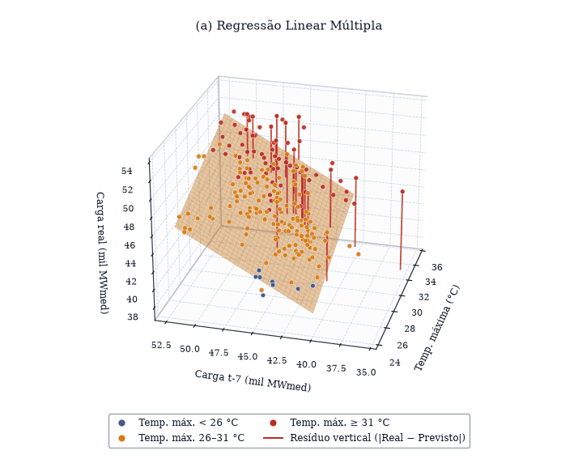
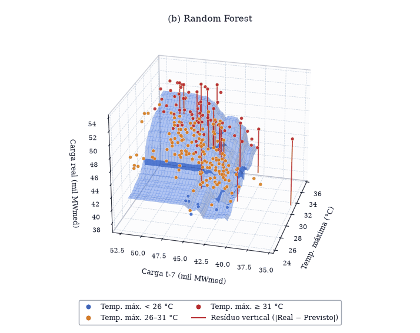
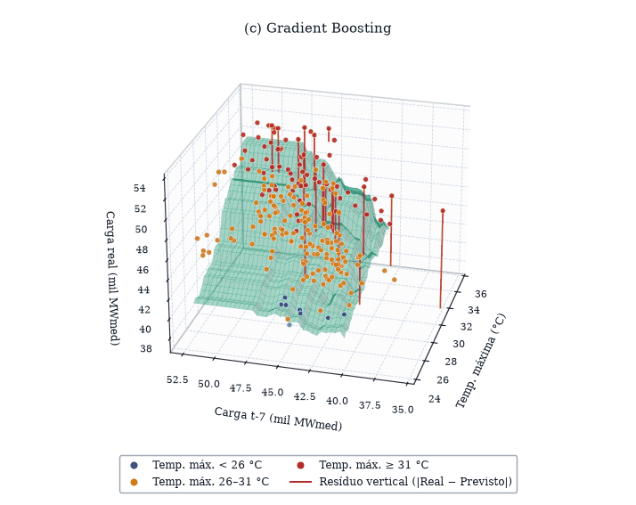
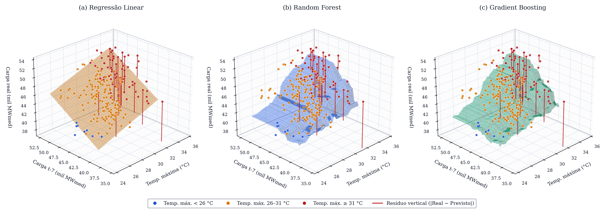
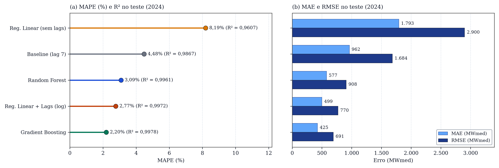

# 4. ETAPA 4 — MODELAGEM E PREVISÃO DE CARGA ELÉTRICA

Esta etapa documenta a construção, o treinamento e a comparação dos modelos de aprendizado de máquina aplicados à previsão de carga elétrica no Sistema Interligado Nacional (SIN), estruturada em duas frentes complementares:

1. **Parte I — Modelo Baseline Mensal (`modelo2.py`):** primeira abordagem por subsistema na escala mensal, utilizando apenas tendência temporal e mês do ano (sem variáveis climáticas).
2. **Parte II — Comparação de Modelos na Base Diária com Clima e Histórico (`comparacao_modelos/`):** evolução para a granularidade diária integrando dados meteorológicos do INMET e histórico recente da demanda (*lags*), comparando **Regressão Linear**, **Random Forest** e **Gradient Boosting** com gráficos científicos gerados em Python (`matplotlib`, 300 DPI) e animações `.gif`.

> **Reprodutibilidade dos artefatos da Parte II:** os códigos-fonte e métricas oficiais permanecem em [`comparacao_modelos/`](comparacao_modelos/README.md), enquanto as figuras científicas (`.png` em 300 DPI) e animações `.gif` em [`imagens/`](imagens/) são geradas de forma reproduzível sobre os dados reais pelo script [`../etapa_5/gerar_graficos.py`](../etapa_5/gerar_graficos.py).

---

# PARTE I — MODELO INICIAL MENSAL (REGRESSÃO LINEAR)

**Código em:** [`modelo2.py`](modelo2.py)

## 1.1. Base de dados

A modelagem utilizou os dados da tabela `gold_fato_carga`, consultada no Amazon Athena. A base contempla o período de janeiro de 2016 a dezembro de 2024, com 13.152 registros diários distribuídos entre os quatro subsistemas.

Para a previsão, os dados foram agregados mensalmente pela média da carga (`val_cargaenergiamwmed`), resultando em 432 registros, sendo 108 para cada subsistema.

| Subsistema           | Carga média (MWmed) |
| -------------------- | ------------------: |
| Norte                |            6.025,39 |
| Nordeste             |           11.018,78 |
| Sudeste/Centro-Oeste |           38.537,02 |
| Sul                  |           11.691,99 |

## 1.2. Análise exploratória

A análise histórica mostrou diferenças no comportamento da carga entre os subsistemas, tanto em relação à escala quanto à variação ao longo dos meses.

Também foram identificados padrões sazonais distintos:

| Subsistema           | Maior média | Menor média |
| -------------------- | ----------- | ----------- |
| Nordeste             | Novembro    | Julho       |
| Norte                | Setembro    | Janeiro     |
| Sudeste/Centro-Oeste | Março       | Julho       |
| Sul                  | Fevereiro   | Maio        |

### Evolução histórica da carga

### Sazonalidade mensal

## 1.3. Modelo utilizado

Foi escolhida uma regressão linear com tendência temporal e sazonalidade mensal, aplicada individualmente a cada subsistema.

O modelo considera duas variáveis principais:

- **Tendência:** representa a evolução da carga ao longo do tempo.
- **Sazonalidade:** utiliza variáveis dummy para representar os meses do ano.

De forma simplificada, o modelo estima a carga a partir da tendência temporal e dos efeitos associados a cada mês.

As variáveis climáticas disponíveis na base não foram incluídas nesta primeira versão, sendo incorporadas na Parte II desta etapa.

## 1.4. Treinamento e avaliação

A divisão dos dados respeitou a ordem cronológica:

| Etapa       | Período     |
| ----------- | ----------- |
| Treinamento | 2016 a 2022 |
| Teste       | 2023 a 2024 |
| Previsão    | 2025        |

Para avaliar o desempenho, foram utilizadas as métricas MAE, RMSE e MAPE. Também foi realizada uma comparação com um modelo de referência (*baseline*), que utiliza a carga observada no mesmo mês do ano anterior.

| Subsistema           | MAPE Regressão | MAPE Baseline |
| -------------------- | -------------: | ------------: |
| Nordeste             |          8,56% |         7,66% |
| Norte                |         16,09% |        10,83% |
| Sudeste/Centro-Oeste |          7,47% |         6,82% |
| Sul                  |          7,09% |         8,09% |

A regressão apresentou resultado melhor que o baseline apenas no subsistema Sul. Nos demais, o modelo de referência obteve menor erro percentual.

O Norte apresentou o maior erro relativo, enquanto o Sul teve o melhor resultado da regressão.

## 1.5. Previsão para 2025

Após a avaliação, o modelo foi ajustado novamente utilizando todo o histórico de 2016 a 2024, gerando previsões mensais para 2025.

Como exemplo, as estimativas para o subsistema Nordeste foram:

| Mês       | Previsão (MWmed) |
| --------- | ---------------: |
| Janeiro   |        12.812,85 |
| Fevereiro |        12.975,56 |
| Março     |        12.986,21 |
| Abril     |        12.626,26 |
| Maio      |        12.577,04 |
| Junho     |        12.210,47 |
| Julho     |        12.155,12 |
| Agosto    |        12.406,14 |
| Setembro  |        12.689,75 |
| Outubro   |        13.255,08 |
| Novembro  |        13.302,38 |
| Dezembro  |        13.231,01 |

## 1.6. Resultados visuais e arquivos do modelo mensal (`modelo2.py`)

| Arquivo | Descrição |
|---|---|
| [`modelo2.py`](modelo2.py) | Script principal da modelagem mensal |
| `metricas_modelo2.csv` | Métricas de avaliação dos modelos mensais |
| `previsoes_teste_modelo2.csv` | Valores reais e previstos no período de teste |
| `previsao_2025_modelo2.csv` | Previsões mensais para 2025 |

---

# PARTE II — COMPARAÇÃO DE ALGORITMOS NA BASE DIÁRIA COM CLIMA E HISTÓRICO RECENTE

**Códigos-fonte oficiais:** [`comparacao_modelos/`](comparacao_modelos/README.md)

Para superar os erros elevados do modelo mensal sem clima e testar as hipóteses `H1`, `H3`, `H4` e `H5` da Etapa 1, a equipe avançou para a **previsão diária**, unindo dados de consumo do ONS, estações meteorológicas do INMET e localização geográfica do IBGE diretamente da camada Gold na AWS (`db_energia_clima_puc`).

## 2.1. Preparação dos dados diários sem vazamento do futuro (`preparacao.py`)

O módulo [`preparacao.py`](comparacao_modelos/preparacao.py) consulta o Amazon Athena entre **2016 e 2024** (`13.152` registros diários nos 4 subsistemas), filtra leituras anômalas de sensores meteorológicos em SQL (como temperaturas médias fora de `-10 °C` a `50 °C` ou radiação acima de `4.500 kJ/m²`) e organiza as entradas em três grupos:

- **Clima (INMET):** temperatura máxima (`temp_max`), média (`temp_media`), mínima (`temp_min`), temperatura do dia anterior, média térmica dos últimos 3 dias, chuva (`precipitacao_total`), radiação solar (`radiacao_global`) e vento (`vento_vel_media`).
- **Calendário e rotina:** subsistema (`SE`, `S`, `NE`, `N`), dia da semana, mês, dia do ano, tendência contínua e indicador de feriados nacionais e pontos facultativos (como Carnaval e Corpus Christi).
- **Histórico recente da carga (*lags*):** consumo observado ontem (`carga_lag_1`), há exatamente 7 dias (`carga_lag_7`) e média móvel dos últimos 7 dias (`carga_media_7d`), sempre calculados olhando apenas para trás no tempo.

A divisão cronológica seguiu rigorosamente a ordem dos anos para nunca vazar informação futura para o treino:

| Etapa | Período | Registros | Papel no experimento |
| :--- | :--- | :---: | :--- |
| **Treino inicial** | `2016` a `2022` | `10.200` | Ajuste inicial durante a busca de hiperparâmetros |
| **Validação** | `2023` | `1.460` | Escolha dos melhores hiperparâmetros sem tocar em `2024` |
| **Retreinamento** | `2016` a `2023` | `11.660` *(c/ lags)* / `11.688` *(s/ lags)* | Incorporação do comportamento mais recente antes do teste final |
| **Teste final (*holdout*)** | `2024` | `1.464` | Avaliação imparcial em dados inéditos de todo o ano bissexto de `2024` |

Para lidar com a diferença de escala entre regiões — o Sudeste consome cerca de `45.000 MWmed`, enquanto o Norte consome cerca de `7.500 MWmed` —, os modelos baseados em árvores e a regressão com defasagens preveem a carga em escala logarítmica e retornam à escala real de Megawatts após a previsão.

## 2.2. Os algoritmos comparados

Nos gráficos tridimensionais abaixo (dias úteis de `2024` no Sudeste/Centro-Oeste), cada bolinha representa um **dia real medido pelo ONS**, enquanto a superfície colorida ("manta") representa o **teto/previsão que cada algoritmo aprendeu** a partir da temperatura máxima do dia e da carga da semana anterior — e as hastes verticais vermelhas mostram o erro entre a realidade e essa superfície:

### 1. Regressão Linear Diária ([`01_regressao_linear.py`](comparacao_modelos/01_regressao_linear.py))
Linha de base diária usando variáveis climáticas e de calendário (sem histórico recente), complementada pela variante **Regressão Linear + Defasagens (`log-log`)**. Sua **superfície laranja** forma uma rampa completamente plana e rígida: ela não consegue fazer curvas quando o consumo acelera acima de `31 °C`, deixando as bolinhas vermelhas de calor muito acima do plano:

### 2. Random Forest ([`03_random_forest.py`](comparacao_modelos/03_random_forest.py))
Conjunto de `400` árvores de decisão paralelas e independentes (`RandomForestRegressor`, `max_features = 0.7`, `min_samples_leaf = 5`), combinadas por média simples (`MAPE` de validação em `2023`: `3,19%`). Sua **superfície azul** divide o espaço em degraus e patamares que moldam uma "montanha" bem próxima da nuvem de dados até a média histórica, mas ainda estagna abaixo dos picos inéditos de `2024`:

### 3. Gradient Boosting ([`02_gradient_boosting.py`](comparacao_modelos/02_gradient_boosting.py))
Conjunto de `400` árvores sequenciais (`HistGradientBoostingRegressor`, `learning_rate = 0.03`, `max_leaf_nodes = 15`, `min_samples_leaf = 10`), em que cada nova árvore corrige os resíduos das anteriores e trata nativamente dias sem medição climática (`MAPE` de validação em `2023`: `3,57%`). Sua **superfície verde** constrói uma encosta contínua moldada erro a erro, ajustando-se de forma mais suave ao aumento de carga nos dias quentes:

### 4. Regra Semanal Simples (`carga_lag_7`)
Referência ingênua que repete diretamente o consumo registrado sete dias antes no mesmo subsistema.

### Comparação estática em alta resolução (300 DPI)

Para visualizar os três ajustes lado a lado em alta resolução, a figura abaixo compara diretamente o plano rígido da Regressão Linear, os blocos do Random Forest e a superfície adaptativa do Gradient Boosting sobre os dias úteis do Sudeste em `2024`:

> **Observação sobre as hastes de erro e o *outlier* pós-feriado (`08/01/2024`):** as linhas verticais vermelhas representam o resíduo (`Real − Previsto`) nos 20 dias de maior desvio. Nota-se um ponto vermelho isolado à direita das superfícies (`Carga t-7 = 35,1 mil MWmed`, `Temp. máxima = 31,6 °C` e `Carga real = 47,1 mil MWmed`): identificamos na base que se trata da segunda-feira **`08/01/2024`**, cuja referência de sete dias antes (`t-7`) foi **`01/01/2024` (feriado de Confraternização Universal)**. Como o consumo no feriado caiu para `35,1 mil MWmed` e retornou ao patamar útil normal na semana seguinte (`+12,0 mil MWmed`), a variável `carga_lag_7` isolada subestima fortemente esse dia. Com isso, fica listada como **sugestão de otimização para a Etapa 6** a filtragem ou sinalização específica de dias úteis cuja semana anterior (`t-7`) tenha sido feriado (`feriado_lag_7`).

## 2.3. Resultados quantitativos no teste inédito de 2024

### O que significa cada métrica da tabela

- **MAE (Erro Médio Absoluto, em MWmed):** média simples de quantos Megawatts o modelo erra em um dia comum (quanto menor, melhor).
- **RMSE (Raiz do Erro Quadrático Médio, em MWmed):** semelhante ao MAE, porém dá peso maior aos erros grandes em dias de pico extremo (quanto menor, melhor).
- **R² (Coeficiente de Determinação):** varia até `1,00` e mostra quanto do comportamento real da carga o modelo conseguiu explicar (quanto mais perto de `1,00`, melhor).
- **MAPE (Erro Percentual Médio, em %):** erro médio relativo ao tamanho de cada região, permitindo comparar Sudeste e Norte em igualdade de condições (quanto menor, melhor).

### Placar global em 2024 (`1.464` dias nos 4 subsistemas)

| Modelo avaliado | MAE (MWmed) | RMSE (MWmed) | R² | MAPE (%) |
| :--- | ---: | ---: | ---: | ---: |
| **Gradient Boosting (Vencedor)** | **424,74** | **691,18** | **0,9978** | **2,20%** |
| **Regressão Linear + Defasagens (`log-log`)** | 499,06 | 769,97 | 0,9972 | **2,77%** |
| **Random Forest (`RandomForestRegressor`)** | 577,26 | 908,39 | 0,9961 | **3,09%** |
| Regra Semanal Simples (`carga_lag_7`) | 961,80 | 1.684,20 | 0,9867 | **4,48%** |
| Regressão Linear Diária (clima e calendário, sem histórico) | 1.793,38 | 2.899,57 | 0,9607 | **8,19%** |

O **Gradient Boosting** obteve o menor erro em todas as métricas avaliadas e foi selecionado como modelo vencedor desta etapa experimental.

---

A interpretação aprofundada de métricas, resíduos e parâmetros ideais, o peso de cada variável de entrada, o comportamento climático no mapa do Brasil por subsistema e as recomendações operacionais para o ONS e AWS são apresentados exclusivamente na [Etapa 5 — Análise dos Resultados](../etapa_5/analise_resultados.md).
