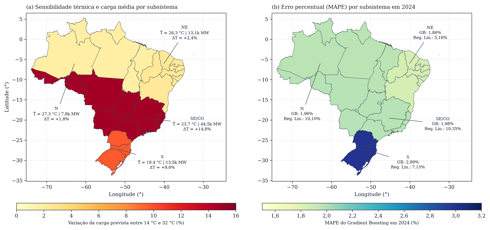
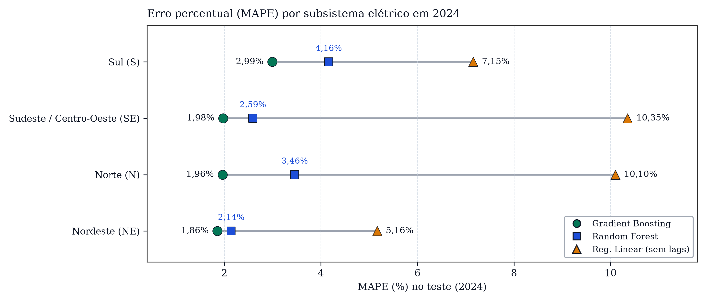
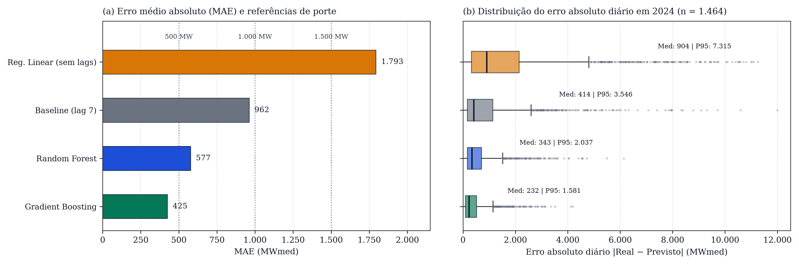
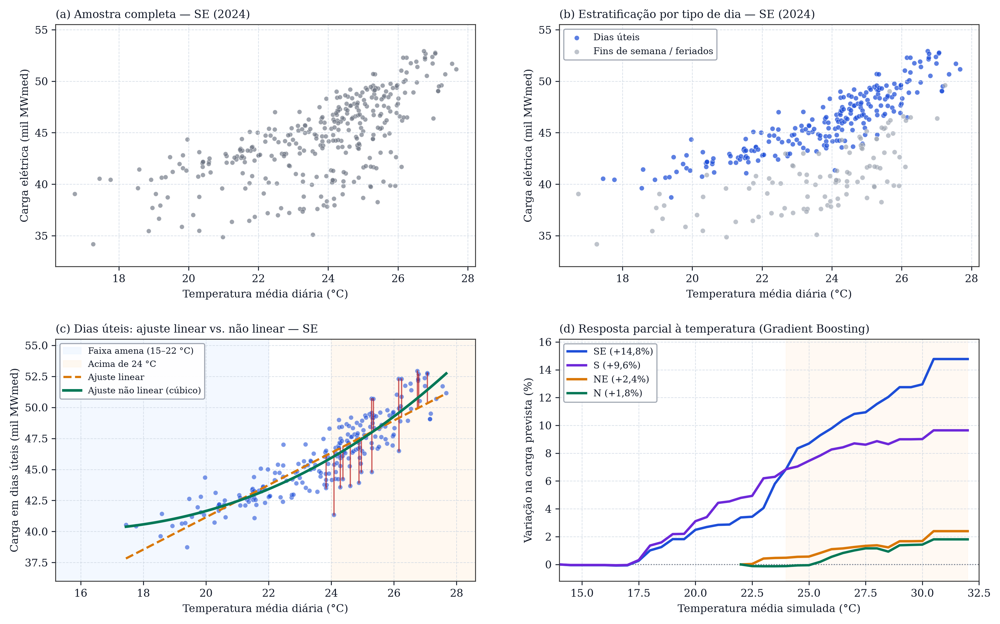
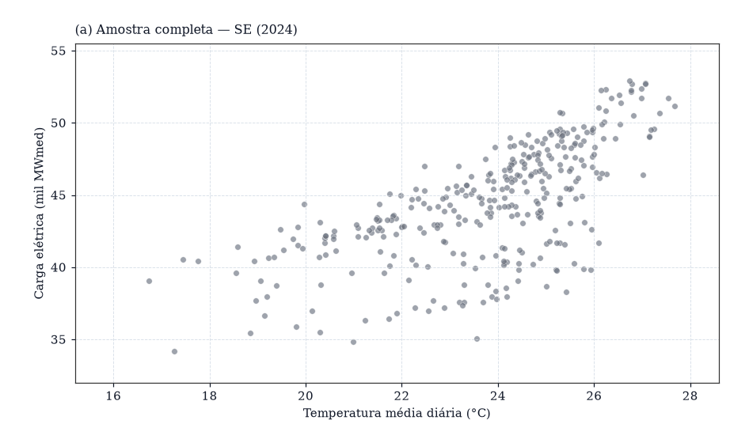
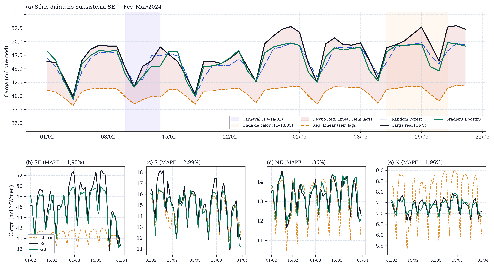
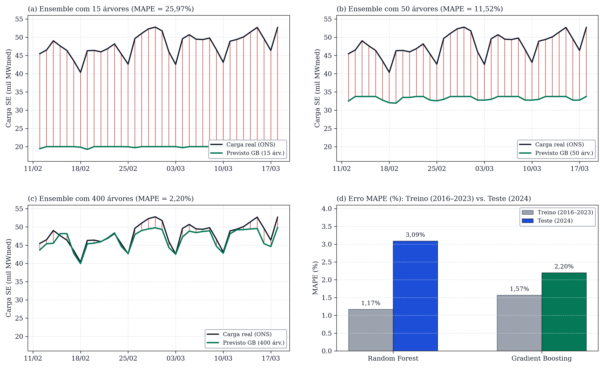
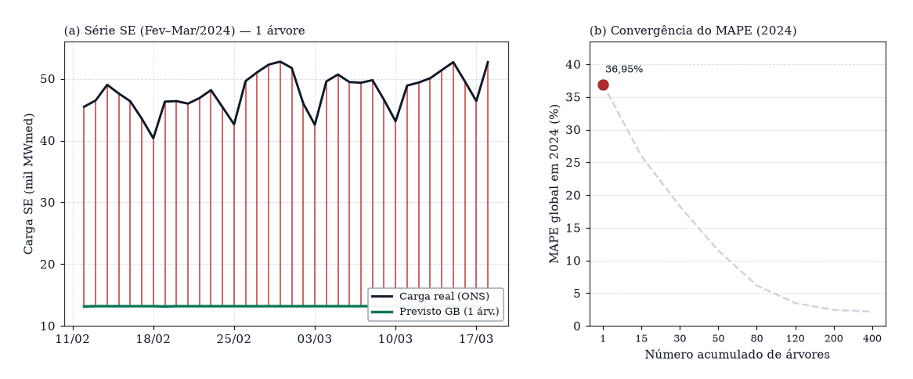
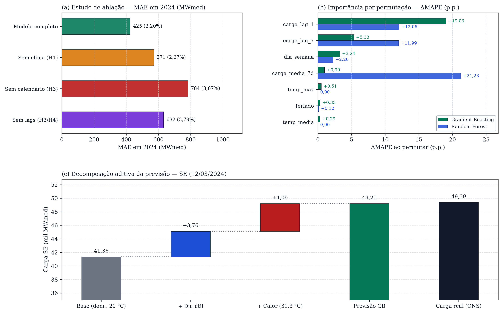

# 5. ETAPA 5 — ANÁLISE DOS RESULTADOS

Esta etapa concentra a análise crítica dos resultados obtidos pelos algoritmos treinados na [Etapa 4](../etapa_4/aprendizado_maquina.md), apresentando primeiro o panorama espacial e climático descoberto nos dados do Brasil e aprofundando, em seguida, as métricas de erro, os hiperparâmetros ótimos, o peso das variáveis de entrada e o impacto operacional para o Operador Nacional do Sistema Elétrico (ONS). Todos os gráficos e animações desta etapa são gerados em Python (`matplotlib` + `scikit-learn`) sobre os dados reais do experimento pelo script [`gerar_graficos.py`](gerar_graficos.py).

---

## 1. Panorama Nacional no Mapa do Brasil e Síntese das Métricas de Erro

### 1.1. Visão geográfica no mapa do Brasil e desempenho por subsistema

Seguindo o mapeamento oficial aplicado na camada Gold (`IBGE` + `ONS`), as 27 Unidades da Federação integram os quatro subsistemas elétricos do Sistema Interligado Nacional (`S`: PR, RS, SC; `SE/CO`: SP, RJ, MG, ES, DF, GO, MS, MT, AC, RO; `NE`: AL, BA, CE, PB, PE, PI, RN, SE; `N`: AM, AP, MA, PA, RR, TO). O mapa abaixo sintetiza no painel **`(a)`** o comportamento térmico e o porte de carga descobertos em `2024` e, no painel **`(b)`**, o erro percentual (`MAPE`) alcançado pelo modelo vencedor frente à regressão linear inicial:

O gráfico de pontos conectados abaixo detalha a queda do erro entre a Regressão Linear diária sem histórico, o Random Forest e o Gradient Boosting vencedor nos quatro subsistemas:

| Subsistema | Temp. Média `2024` | Carga Média `2024` | Sensibilidade `14→32 °C` | Linear Mensal (`modelo2.py`, `23–24`) | Linear Diária (s/ lags) | Linear + Lags (`log-log`) | Baseline (`lag 7`) | Random Forest | Gradient Boosting |
| :--- | :---: | :---: | :---: | :---: | :---: | :---: | :---: | :---: | :---: |
| **Sudeste/Centro-Oeste (`SE`)** | `23,7 °C` | `44,5 mil MWmed` | **`+14,8%`** | `7,47%` | `10,35%` | `2,17%` | `5,11%` | `2,59%` | **`1,98%`** |
| **Sul (`S`)** | `19,4 °C` | `13,5 mil MWmed` | **`+9,6%`** | `7,09%` | `7,15%` | `4,08%` | `7,23%` | `4,16%` | **`2,99%`** |
| **Nordeste (`NE`)** | `26,3 °C` | `13,1 mil MWmed` | **`+2,4%`** | `8,56%` | `5,16%` | `2,04%` | `3,00%` | `2,14%` | **`1,86%`** |
| **Norte (`N`)** | `27,3 °C` | `7,8 mil MWmed` | **`+1,8%`** | `16,09%` | `10,10%` | `2,80%` | `2,56%` | `3,46%` | **`1,96%`** |

1. **Superação da modelagem mensal inicial (`modelo2.py`):** avaliada em `2023–2024` apenas com tendência temporal e mês do ano, a regressão mensal subestimou sistematicamente a demanda nos quatro subsistemas, perdendo para a referência do mesmo mês do ano anterior no Nordeste (`8,56%` vs. `7,66%`), Norte (`16,09%` vs. `10,83%`) e Sudeste (`7,47%` vs. `6,82%`). A passagem para a escala diária com clima do INMET e defasagens recentes eliminou essa defasagem estrutural.
2. **Sudeste/Centro-Oeste (`SE` — `1,98%`):** maior polo consumidor (`44,5 mil MWmed` de média em `2024`) e maior sensibilidade térmica do país (**`+14,8%`** entre `14 °C` e `32 °C`). Sem defasagens, a Regressão Linear diária errava `10,35%` por subestimar o crescimento pós-2023 e o disparo urbano de refrigeração; o Gradient Boosting reduziu o erro em **81%**.
3. **Norte (`N` — `1,96%`):** opera em patamar térmico elevado todo o ano (média de `27,3 °C` em `2024`, com variação adicional contida de `+1,8%` até `32 °C`), mas registrou forte salto estrutural de demanda entre o segundo semestre de `2023` e `2024` (próximo de `8,9 mil MWmed`). O Gradient Boosting acompanhou o novo nível, cortando o erro em **81%** frente à Regressão Linear (`10,10%`) e superando o Random Forest (`3,46%`).
4. **Nordeste (`NE` — `1,86%`):** apresentou o menor erro relativo do Brasil em `2024`. Com temperatura média alta e regular (`26,3 °C`, sensibilidade adicional de `+2,4%`), a combinação de calendário semanal e histórico recente mantém altíssima previsibilidade.
5. **Sul (`S` — `2,99%`):** região mais fria na média (`19,4 °C`) e de maior contraste entre estações (invernos com aquecimento elétrico/chuveiros e verões com `+9,6%` de subida térmica). Mesmo superando o Random Forest (`4,16%`) e a Regressão Linear com *lags* (`4,08%`), segue como a região de maior erro residual devido às frentes frias rápidas.

### 1.2. Métricas globais de erro e distribuição dos desvios diários (`2024`)

Como a variável-alvo do projeto (`val_cargaenergiamwmed`, em MWmed) é numérica contínua, toda a avaliação utiliza métricas de **Regressão** (`MAE`, `RMSE`, `R²` e `MAPE`), não se aplicando matriz de confusão típica de classificação discreta. Em contrapartida à matriz de confusão, a inspeção da **distribuição dos `1.464` erros absolutos diários (`|Real − Previsto|`)** no conjunto inédito de `2024` revela tanto o comportamento típico quanto a cauda de eventos extremos:

| Modelo avaliado no teste de `2024` (`1.464` dias) | MAE (MWmed) | RMSE (MWmed) | R² | MAPE (%) |
| :--- | ---: | ---: | ---: | ---: |
| **Gradient Boosting (`HistGradientBoosting` + log)** | **424,74** | **691,18** | **0,9978** | **2,20%** |
| **Regressão Linear + Defasagens (`log-log`)** | 499,06 | 769,97 | 0,9972 | **2,77%** |
| **Random Forest (`RandomForestRegressor` + log)** | 577,26 | 908,39 | 0,9961 | **3,09%** |
| Modelo de Referência Semanal (`carga_lag_7`) | 961,80 | 1.684,20 | 0,9867 | **4,48%** |
| Regressão Linear Diária (clima e calendário, sem defasagens) | 1.793,38 | 2.899,57 | 0,9607 | **8,19%** |

- **MAE (*Mean Absolute Error*, em MWmed):** média simples do erro diário em Megawatts médios (quanto menor, melhor).
- **RMSE (*Root Mean Squared Error*, em MWmed):** raiz do erro quadrático médio; penaliza mais fortemente desvios elevados em picos extremos.
- **R² (Coeficiente de Determinação):** proporção da variabilidade real explicada pelo modelo (até `1,00`).
- **MAPE (*Mean Absolute Percentage Error*, em %):** erro médio relativo à carga observada, permitindo comparar subsistemas de escalas distintas.

No painel **`(a)`**, a Regressão Linear diária sem histórico apresenta `MAE` de **`1.793,38 MWmed`** — superior a três usinas térmicas médias de `500 MW` —, enquanto o **Gradient Boosting** reduz o erro típico para **`424,74 MWmed`** (abaixo de uma usina de `500 MW`). O painel **`(b)`** detalha os percentis dos `1.464` erros diários (`|Real − Previsto|`):

- **Gradient Boosting:** mediana de **`232,1 MWmed`**, `Q3` (`75%` dos dias) em **`521,1 MWmed`** e `P95` em **`1.580,7 MWmed`** (máximo de `4.186,1 MWmed`).
- **Random Forest:** mediana de **`342,9 MWmed`**, `Q3` em **`706,1 MWmed`** e `P95` em **`2.037,0 MWmed`** (máximo de `6.140,9 MWmed`).
- **Baseline Semanal (`lag 7`) e Regressão Linear (sem lags):** o baseline semanal registra mediana de `414,2 MWmed`, mas salta para **`P95 = 3.545,9 MWmed`** (máximo de `11.998,7 MWmed`) em feriados e ondas de calor; já a Regressão Linear sem histórico acumula mediana de **`904,4 MWmed`**, `Q3` de **`2.144,6 MWmed`** e **`P95 = 7.315,3 MWmed`** (máximo de `11.251,8 MWmed`).

---

## 2. Descobertas Climáticas e Operacionais: O "Efeito Ar-Condicionado" e os Eventos Críticos de 2024

### 2.1. Isolando a rotina semanal e o disparo acima de `24 °C`

Para compreender fisicamente a sensibilidade térmica vista no mapa do Brasil e explicar por que modelos lineares falham quando o calor aperta, o estudo isolou progressivamente o efeito do calendário e da temperatura no Sudeste em `2024`:

*Versão animada (transição em 4 estágios da amostra bruta até o ajuste não linear acima de `24 °C`):*

1. **Amostra completa misturada — painel `(a)`:** ao plotar todos os dias sem distinguir rotina, os pontos parecem dispersos porque **um domingo quente (`26 °C`) consome menos energia que uma quarta-feira fria (`18 °C`)** devido ao fechamento de indústrias, comércios e escolas.
2. **Estratificação por tipo de dia — painel `(b)`:** separando **dias úteis** (azul) de **fins de semana e feriados** (cinza), surgem duas camadas paralelas separadas por uma diferença média de rotina de **`~5,3 mil MWmed`**.
3. **Dias úteis isolados e o salto acima de `24 °C` — painel `(c)`:** mantendo apenas os dias úteis, nota-se que entre `15 °C` e `22 °C` (**faixa amena de conforto térmico**) o consumo varia pouco. Ao ultrapassar **`24 °C`**, o acionamento simultâneo de sistemas de ar-condicionado e refrigeração produz uma curva ascendente não linear (verde), enquanto a reta linear (tracejado laranja) subestima sistematicamente os dias quentes (hastes vermelhas de resíduo).
4. **Resposta parcial aprendida pelo Gradient Boosting — painel `(d)`:** mantendo os demais preditores constantes nos dias úteis de `2024` e variando apenas a temperatura média simulada entre `14 °C` e `32 °C`, reproduzem-se os patamares diferenciados mapeados por região (**`+14,8%`** no `SE`, **`+9,6%`** no `S`, **`+2,4%`** no `NE` e **`+1,8%`** no `N`).

### 2.2. Eventos críticos reais em `2024`: Carnaval e ondas de calor

No recorte crítico de **1º de fevereiro a 20 de março de 2024** no Sudeste — painel `(a)` — e na janela de **fevereiro a março (`01/02` a `31/03`)** nos quatro subsistemas — painéis `(b)` a `(e)` — observam-se dois testes práticos decisivos:

1. **Retração abrupta no Carnaval (`10` a `14/02/2024`, faixa lilás):** em plena segunda e terça-feira útil, o fechamento comercial e industrial derruba a carga elétrica para níveis próximos aos de um domingo. A presença da variável `feriado` (cobrindo feriados nacionais e pontos facultativos) permitiu ao **Gradient Boosting** antecipar a queda em pleno meio da semana e retomar a curva na quarta-feira de Cinzas.
2. **Ondas de calor de março de `2024` (faixa laranja):** a Regressão Linear diária sem histórico (tracejado laranja) fica estagnada entre `41` e `42 mil MWmed`, acumulando desvio de até **`11,0 mil MWmed`** em um único dia. O Gradient Boosting acompanha as variações térmicas e semanais muito acima dos concorrentes: em **`12/03/2024`**, acertou **`99,6%`** da medição real (`49,2` mil previstos contra `49,4 mil MWmed` observados) e, no recorde extremo de **`19/03/2024`** (`52,9 mil MWmed`, acima do teto histórico aprendido até `2023`), avançou até `49,6 mil MWmed`.

---

## 3. Parâmetros Ideais, Correção Sequencial de Resíduos e Controle de *Overfitting*

Na busca de hiperparâmetros sobre a partição de validação (`2023`), os parâmetros ideais revelaram por que o **Gradient Boosting** generalizou melhor que o **Random Forest** ao enfrentar `2024`:

1. **Parâmetros ideais e correção sequencial de resíduos (`Gradient Boosting`):** a combinação selecionada (`learning_rate = 0.03`, `max_iter = 400`, `max_leaf_nodes = 15`, `min_samples_leaf = 10`; `MAPE` na validação `2023 = 3,57%`) utiliza árvores rasas e passos suaves aplicados em sequência sobre o resíduo restante da etapa anterior. Conforme mostram os painéis **`(a)`**, **`(b)`** e **`(c)`** na janela de verão do Sudeste (`11/02` a `18/03/2024`), o conjunto cai de **`25,97%`** de erro global com `15` árvores para **`11,52%`** com `50` árvores, até atingir **`2,20%`** com `400` árvores ajustadas.
2. **Aprender padrões gerais vs. decorar o passado — painel `(d)`:** no `Random Forest` (`n_estimators = 400`, `max_features = 0.7`, `min_samples_leaf = 5`; validação `2023 = 3,19%`), as árvores paralelas obtiveram erro menor no próprio treino `2016–2023` (`MAPE = 1,17%`, `R² = 0,9992`), porém saltaram para **`3,09%`** em `2024` — degradação de **`+1,92` pontos percentuais** típica de *overfitting*. O **Gradient Boosting** foi de `1,57%` (`R² = 0,9989`) no treino para **`2,20%`** no teste (salto de apenas **`+0,63` p.p.**).
3. **Tratamento nativo de falhas meteorológicas:** conforme documentado na [Etapa 3](../pre_processamento.md), a tabela climática bruta do INMET registra entre `14,97%` e `21,41%` de valores ausentes. O `HistGradientBoostingRegressor` aprende o melhor caminho para dados faltantes diretamente nos cortes das árvores, enquanto a Regressão Linear e o Random Forest dependem de imputação pela mediana, atenuando extremos térmicos.

*Versão animada (fechamento progressivo dos resíduos verticais e queda do MAPE conforme o número de árvores cresce):*

---

## 4. Impacto das Variáveis de Entrada e Validação das Hipóteses (`H1`, `H3`, `H4` e `H5`)

Das cinco hipóteses definidas na [Etapa 1](../inicio_do_projeto.md), a hipótese **`H2`** refere-se à geração hidrelétrica (`gold_fato_hidrologia`), permanecendo fora desta frente focada em demanda de energia (`val_cargaenergiamwmed`). As quatro hipóteses relativas à carga (**`H1`, `H3`, `H4` e `H5`**) foram validadas por ablação, permutação e decomposição de caso real:

### 4.1. Estudo de ablação — impacto da remoção de grupos (`H1`, `H3` e `H4`) — painel `(a)`

| Cenário avaliado em `2024` | GB MAE (MWmed) | GB RMSE (MWmed) | GB R² | GB MAPE (%) | RF MAE (MWmed) | RF MAPE (%) |
| :--- | ---: | ---: | ---: | ---: | ---: | ---: |
| **Modelo Completo (Clima + Calendário + Histórico)** | **424,74** | **691,18** | **0,9978** | **2,20%** | 577,26 | 3,09% |
| Sem variáveis climáticas (`confirma H1`) | 570,90 | 952,18 | 0,9958 | 2,67% | 543,65 | 2,67% |
| Sem Calendário / Feriados (`confirma H3`) | 783,73 | 1.280,54 | 0,9923 | 3,67% | 801,68 | 3,95% |
| Sem Histórico Recente — *lags* (`confirma H3 e H4`) | 632,06 | 859,09 | 0,9965 | 3,79% | 1.024,53 | 5,41% |

- **Confirmação de `H1` (clima reduz erros nos extremos):** remover as variáveis meteorológicas do INMET faz o `MAE` do Gradient Boosting subir de `424,74` para `570,90 MWmed` (**`+34,4%`**) e o `RMSE` saltar de `691,18` para `952,18 MWmed` (**`+37,8%`**). No Random Forest, retirar o clima reduziu ligeiramente o erro global (`3,09%` → `2,67%`), mostrando que a imputação pela mediana adicionou ruído às árvores paralelas, ao passo que o Gradient Boosting aproveitou o sinal climático real.
- **Confirmação de `H3` (calendário e histórico recente):** excluir dia da semana e feriados eleva o `MAE` do Gradient Boosting a `783,73 MWmed` (**`+84,5%`**); excluir os *lags* eleva o `MAPE` para `3,79%`.
- **Confirmação de `H4` (superioridade não linear em horizonte aberto):** avaliando exatamente o mesmo conjunto **sem defasagens de carga** (apenas clima e calendário), a Regressão Linear registra `MAPE = 8,19%`, o Random Forest cai para `5,41%` e o Gradient Boosting alcança **`3,79%`**.

### 4.2. Importância das variáveis por permutação (`H5`) — painel `(b)`

Embaralhando uma coluna por vez no teste de `2024` (excluindo `id_subsistema`, cuja permutação apenas troca a escala entre `SE/CO` e `N`), quantifica-se o aumento do `MAPE` em pontos percentuais (`p.p.`):

| Ordem | Variável | Bloco | ΔMAPE no GB (p.p.) | ΔMAPE no RF (p.p.) | Papel na previsão |
| :---: | :--- | :--- | ---: | ---: | :--- |
| 1 | `carga_lag_1` | Defasagem | `+19,03 p.p.` | `+12,06 p.p.` | Inércia operacional do dia imediatamente anterior. |
| 2 | `carga_lag_7` | Defasagem | `+5,33 p.p.` | `+11,99 p.p.` | Ciclo semanal idêntico de sete dias atrás. |
| 3 | `dia_semana` | Calendário | `+3,24 p.p.` | `+2,26 p.p.` | Distinção entre carga útil comercial/industrial e fim de semana. |
| 4 | `carga_media_7d` | Defasagem | `+0,99 p.p.` | `+21,23 p.p.` | Patamar médio recente da demanda na última semana. |
| 5 | `temp_max` | Clima (INMET) | `+0,51 p.p.` | `0,00 p.p.` | Principal preditor climático; capta picos vespertinos de calor. |
| 6 | `feriado` | Calendário | `+0,33 p.p.` | `+0,12 p.p.` | Quedas abruptas de carga em feriados nacionais e Carnaval. |
| 7 | `temp_media` | Clima (INMET) | `+0,29 p.p.` | `0,00 p.p.` | Desconforto térmico acumulado ao longo das 24 horas. |
| 8–12 | `dia_ano`, `temp_min`, `radiacao_global`, `mes`, `vento_vel_media` | Clima / Calendário | `+0,01` a `+0,06 p.p.` | `≤ 0,00 p.p.` | Refinamentos sazonais finos (estação, noites quentes, sol e vento). |

Essa diferença revela por que o **Gradient Boosting** superou o **Random Forest**: o Random Forest concentrou quase todo o peso em `carga_media_7d` (`+21,23 p.p.`) e nos *lags* (`+12,06` e `+11,99 p.p.`), atribuindo **peso nulo (`0,00 p.p.`) às temperaturas máxima e média**. O Gradient Boosting usou o histórico recente para ancorar o nível diário e acionou ativamente `temp_max` (`+0,51 p.p.`), `feriado` (`+0,33 p.p.`) e `temp_media` (`+0,29 p.p.`) para corrigir choques climáticos e de calendário.

### 4.3. Decomposição aditiva de um dia real (`12/03/2024`) — painel `(c)`

Simulando passo a passo com o Gradient Boosting vencedor sobre uma terça-feira real de calor no Sudeste (**`12/03/2024`, máxima de `31,3 °C`**):

1. **Base em fim de semana com clima ameno (`20 °C`, domingo):** **`41,36 mil MWmed`** (`41.357,8 MWmed`).
2. **+ Rotina de dia útil (terça-feira):** acréscimo de **`+3,76 mil MWmed`** (`+3.759,9 MWmed`), atingindo `45,12 mil MWmed` (`45.117,7 MWmed`).
3. **+ Onda de calor real (`31,3 °C` medida pelo INMET):** acréscimo térmico de **`+4,09 mil MWmed`** (`+4.092,5 MWmed`), alcançando previsão final de **`49,21 mil MWmed`** (`49.210,2 MWmed`).
4. **Carga real oficial do ONS:** **`49,39 mil MWmed`** (`49.386,9 MWmed`) — diferença residual de apenas **`176,7 MWmed` (`0,36%`)**.

---

## 5. Apoio à Tomada de Decisão no ONS, Sustentabilidade, LGPD e Evolução da Arquitetura AWS

### 5.1. Impacto na operação do ONS, sustentabilidade e conformidade com a LGPD

- **Redução do risco na Programação Diária da Operação (PDO):** cortar o `MAE` de `1.793,38 MWmed` (Regressão Linear sem histórico) para **`424,74 MWmed`** (ganho médio de `1.368,64 MWmed`) e o erro `P95` de `7.315,3 MWmed` para **`1.580,7 MWmed`** garante margem muito mais segura para equilibrar oferta e demanda diária no SIN.
- **Sustentabilidade e redução de emissões:** picos térmicos subestimados exigem despacho emergencial de **usinas termelétricas fósseis (gás, óleo ou carvão)** — elevando tarifas ao consumidor e emissões de CO₂. Previsões diárias sensíveis à temperatura permitem planejar antecipadamente reservatórios hidrelétricos e fontes renováveis (solar e eólica).
- **Horizonte operacional (`D+1`) vs. projeções longas:** por empregar `carga_lag_1`, o modelo principal destina-se à programação diária de curto prazo (`D+1`). Para horizontes de meses à frente — sem carga recente observada —, recomenda-se a variante **Gradient Boosting sem defasagens (`MAPE = 3,79%`)**, ainda muito superior à Regressão Linear (`8,19%`) e ao Random Forest (`5,41%`).
- **Governança e LGPD:** todos os conjuntos utilizados provêm de bases públicas oficiais agregadas por subsistema e estação meteorológica (`ONS`, `INMET` e `IBGE`), inexistindo dados pessoais ou individuais de consumidores (conformidade integral com a LGPD).

### 5.2. Avaliação da camada Gold AWS (`db_energia_clima_puc`) e propostas de melhoria

Sob a ótica de DataOps e MLOps, o Data Lake Medalhão na AWS sustentou todo o experimento com agilidade e apontou melhorias concretas para a Etapa 6:

1. **Eficiência atual na nuvem (Amazon S3 + AWS Glue + Amazon Athena):** a camada Gold armazena **`2.561.702` registros** em sete tabelas no formato colunar **Parquet** com compressão **Snappy**, particionadas por `year`/`month`. O Athena integra em segundos `1.703.674` leituras climáticas do INMET aos `13.152` registros de carga do ONS diretamente na nuvem.
2. **Gargalos identificados no fluxo atual:** a cada execução com atualização na nuvem, o pipeline precisa refazer o mapeamento UF → Subsistema, filtrar **`1.005` anomalias de sensores**, aplicar **`LEFT JOIN`** para preservar **`1.084` ocorrências subsistema-dia sem leitura climática** (mantendo contínuos os *lags*) e recalcular todas as defasagens e feriados em memória no Python.
3. **Melhorias recomendadas para produção e otimização (Etapa 6):**
   - **Redução de resíduos via diagnóstico ponto a ponto (Engenharia de Atributos):** além do tratamento de dias pós-feriado (`feriado_lag_7`, caso de `08/01/2024` vs. `01/01/2024`), incluir variáveis para pontes de feriado (`ponte_feriado`), graus-dia de resfriamento (`CDD` acima de `24 °C`) e calor acumulado em ondas de calor consecutivas.
   - **Redução de resíduos via algoritmo e estratégia de modelagem:** testar modelos híbridos (tendência linear para extrapolar novos tetos + Gradient Boosting nos resíduos), retreinamento periódico em janela deslizante (*walk-forward*) e *ensembles*/algoritmos regularizados (ex.: `XGBoost` / `LightGBM`).
   - **Tabela diária materializada (`gold_carga_clima_subsistema_diario`):** persistir na Gold a visão diária limpa e agregada por subsistema, reduzindo custos de *scan* no Athena e padronizando a mesma fonte entre BI e ML.
   - ***Feature Store* dedicada:** armazenar as *features* temporais pré-computadas (`carga_lag_1`, `carga_lag_7`, `carga_media_7d`, `feriado`), evitando divergência entre cálculo de treino e inferência (*training-serving skew*).
   - **Monitoramento de *drift* e retreinamento automático:** rastrear métricas por região (ex.: via `MLflow` com alertas de mudança de patamar) para disparar retreinamento automático diante de saltos estruturais como o ocorrido no Norte em `2023–2024`.

---

## 6. Referências Bibliográficas e Documentação do Projeto

- **Documentos anteriores da equipe:** [Etapa 1 — Início do Projeto](../inicio_do_projeto.md), [Etapa 2 — Coleta de Dados](../coleta_dados.md), [Etapa 3 — Pré-processamento](../pre_processamento.md) e [Etapa 4 — Aprendizagem de Máquina](../etapa_4/aprendizado_maquina.md).
- **Códigos e scripts oficiais:** [Comparação de Modelos (`preparacao.py` e scripts `01` a `03`)](../etapa_4/comparacao_modelos/README.md), [Script gerador das figuras (`gerar_graficos.py`)](gerar_graficos.py) e [`modelo2.py`](../etapa_4/modelo2.py).
- **CASTRO, Leandro Nunes de; FERRARI, Daniel Gomes.** *Introdução à mineração de dados: conceitos básicos, algoritmos e aplicações.* São Paulo: Saraiva, 2016.
- **FACELI, Katti et al.** *Inteligência artificial: uma abordagem de aprendizado de máquina.* 2. ed. Rio de Janeiro: LTC, 2021.
- **GÉRON, Aurélien.** *Mãos à obra: aprendizado de máquina com Scikit-Learn, Keras & TensorFlow.* 2. ed. Rio de Janeiro: Alta Books, 2021.
- **HYNDMAN, Rob J.; ATHANASOPOULOS, George.** *Forecasting: Principles and Practice.* 3. ed. OTexts, 2021.
- **SCIKIT-LEARN DEVELOPERS.** *Ensemble methods — HistGradientBoostingRegressor, RandomForestRegressor, TransformedTargetRegressor & Permutation Importance.* Documentação Oficial. Disponível em: <https://scikit-learn.org/stable/modules/ensemble.html>.
- **AMAZON WEB SERVICES (AWS).** *Amazon Athena & AWS Glue User Guide — Performance Tuning and Partitioning in Parquet.* Disponível em: <https://docs.aws.amazon.com/athena/>.
- **ONS — Operador Nacional do Sistema Elétrico.** *Dados Abertos — Carga de Energia Diária por Subsistema.* Disponível em: <https://dados.ons.org.br/>.
- **INMET — Instituto Nacional de Meteorologia.** *Banco de Dados Meteorológicos (BDMEP / Base dos Dados).* Disponível em: <https://portal.inmet.gov.br/>.
